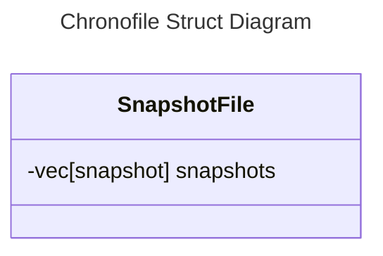

# Overview

ChronoFile is a library which is designed to be a drop in replacement for std::fs::File with additional snapshotting. It allows users to rollback to previous snapshots easily and quickly without taking up too much space on disk.

## Design constraints
- Snapshot data shall be stored separately from the current file.
- All snapshot data shall be stored in a single compressed binary file.
- Snpashot data is only loaded in when needed

## Functional requirements
- The system shall allow a user or calling program to restore a file to a selected previous snapshot.
- The system shall verify the integrity of the selected snapshot before applying it.
- If verification fails, the system shall not replace the current file and shall report an error.

## Non-functional requirements
- Rollback shall complete within a defined time for specified file sizes and snapshot counts. For example: “A rollback shall complete within 2 seconds for files up to 100 MB with up to 100 versions on the supported reference machine.”
- Rollback shall preserve the current file if the operation fails or is interrupted.
- The interface shall be compatible with the required std::fs::File operations

# Core Entities

- ChronoFile Interface: The public Struct used
- File: The actual data file
- SnapshotFile: An append only log. The file containing the snapshot information
- Snapshot: A compressed version of the File. A snapshot of that at a specific point in time.

# User Stories

The follow user stories define ChronoFile specific operations

## User commits a version

- User calls the `commit()` method
- Since this is a single writer (not async friendly ATM) don't lock the file
- Create a new `snapshot`:
  - Hash the contents of the `File` 
  - Compress the data of the `File`
  - Generate a unique ID - UUID v7 for time serializable
- Read the `SnapshotFile`: 
  - Decompress and deserialise. Return error if either fail.
  - Compare the hash with the deserialised file. Return error if it fails.
- Add a new `Snapshot` to the array
- Save the `SnapshotFile`: 
  - Hash the contents of the updated `SnapshotFile` and update the hash parameter
  - serialize and compress
- return

## User lists versions

- User calls `iter()` method on `Chronofile` struct
- Read the `snapshotFile`
- Return iterator over `Snapshot` references in BTreeMap to the caller

## User previews a version

- User calls `preview(version)` or `preview_at(timestamp)` method on `ChronoFile` struct
- Read the `SnapshotFile` see above for details
- If version:  
- If timestamp: compare keys to timestamp and return the snapshot at that timestamp, i.e. key < timestamp and key + 1 > timestamp. 
- Return the `Snapshot` to the user

## User restores a version

- User calls `restore(version)` or `restore_at(timestamp)` methods on `ChronoFile` struct
- Read the `SnapshotFile` see above for details
- If version: Read the key directly O(1) 
- If timestamp: compare keys to timestamp and return the snapshot at that timestamp, i.e. key < timestamp and key + 1 > timestamp.
- Overwrite the `File` with the new snapshot and then create a new snapshot with `commit()` to log the change.

# Decisions and Future Improvements

- crc32 is chosen as the checksum because it is designed to detect accidental changes to digital data and returns a fixed u32.
- data is compressed for each snapshot
- the entire data is compressed

# Potential Improvements

- Keys are UUIDv7 -> 128 bits. This could potentially be reduced.
- The entire file is stored as a snapshot. This could lead to a large file being generated if there are lots of snapshots stored.

